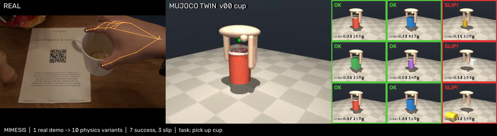

# MIMESIS

Film one grab with your phone. Get a robot dataset.

**Live demo:** https://lennilehtonen.github.io/mimesis/



You film yourself picking up a cup. MIMESIS tracks your hand and the cup in 3D, a simulated robot gripper copies the motion frame by frame in MuJoCo, and the physics then replays it with different cups, weights and frictions. Each replay is labelled OK or SLIP and exported as a LeRobot v3 dataset.

Built at NullHacks Helsinki, 21 November 2026.

## How it works

1. **Film.** One iPhone on a stand, used as the Mac's camera. An A4 sheet on the table tells us where the table is and how big things are.
2. **Track.** MediaPipe finds the hand (21 points) and the cup in every frame. Using the hand's real size, the A4 sheet and the camera's lens, we get both in 3D on the table.
3. **Copy.** The robot gripper follows the hand in real time: it moves where your grip is, closes when your hand closes, and carries the cup while you hold it.
4. **Multiply.** The same motion is replayed with other objects, masses, frictions and positions. If the grip can't hold the object, it slips.
5. **Export.** Video, robot motion, grab/release events and OK/SLIP labels go into a LeRobot v3 dataset.

## Run it

```bash
./run.sh          # macOS, Python 3.12, ffmpeg. Opens http://localhost:8000
```

The dashboard has four tabs: **Record** (camera with live hand tracking), **Episode** (your video next to the robot copy), **Multiply** (simulated variants), **Ship** (export).

Without the UI:

```bash
python jobs.py process <episode>          # track hand and cup, build the robot copy
python jobs.py multiply <episode> --n 10  # simulated variants
python jobs.py export                     # LeRobot v3 dataset
python test_pipeline.py                   # end-to-end test, no phone needed
```

## Filming a take

1. Put the phone on a stand about 50 cm above the table, pointing down. Don't move it.
2. Lay an A4 sheet flat on a dark table, fully in view, with the cup next to it.
3. Press RECORD and wait 3 seconds with nothing moving.
4. With one hand: grab the cup from above, lift it, move it, put it down, open your hand, pull it out.
5. Keep your whole hand in view. Press RECORD again to stop.

## Results

From one 49-second take (`ep_173510`):

| | |
|---|---|
| Hand found | 68 % of frames |
| Cup found | 95 % of frames |
| Robot copy | grasps and lifts the cup 12 cm, in time with the video |
| 10 simulated variants | 7 OK, 3 SLIP (low friction or heavy objects) |


## Limits

- One camera: depth is off by about 2 to 5 cm.
- Needs the A4 sheet and a camera that stays still.
- Hand tracking drops when the hand is side-on or covered.
- The robot hand is a two-jaw gripper, and slipping uses a simple grip-force model.


## License

MIT
