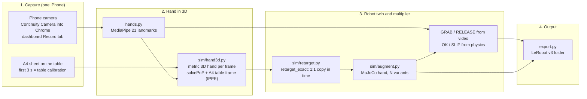

# MIMESIS

**μίμησις** *(mímēsis)* — Ancient Greek for *imitation*: the representation of the real world in another medium.

> **Film one real grab with your phone. Simulate a thousand.**

MIMESIS turns one short phone video of a human hand picking up a cup into a physics-labelled robot dataset. One iPhone films the table from above (Continuity Camera into Chrome). No wrist IMU and no other sensors. A Mac tracks the hand with MediaPipe, lifts it to a metric 3D hand using an A4 sheet on the table as calibration, and makes a robot hand in MuJoCo copy the human hand 1:1 in time. It then replays that motion across many physically varied worlds (mass, friction, size, position) and labels each variant OK or SLIP from the physics. The result is exported as a LeRobot v3 dataset.

Built at [NullHacks Helsinki](docs/PITCH.md) (21 November 2026). Theme: *“Everyone is working on physical AI… find an awesome way to **simulate** any data you find cool. End result could be a dataset, a model, a simulation that could be deployed to collect this data, whatever.”* Judged on coolness, technical complexity, and creativity.

License: [MIT](#license).

---

## Why this exists

Physical-AI labs cannot scrape a Common Crawl of contact. Egocentric video is cheap; **force, slip onset, and “how hard did I set this down” are not**. Pure wearable IMUs look like a shortcut to XYZ position, but double-integrating a consumer accelerometer drifts **meters in seconds** (bias integrates as \(t^2\); attitude error lets gravity leak and can grow as \(t^3\)). Teleoperation rigs and tactile fingers are expensive. What scales is a **collection protocol plus a physics multiplier**: record a real human demonstration once, then simulate the rare failures and contact transients labs actually need.

MIMESIS does not claim that IMU-only XYZ is solved. The opposite is the point: **the camera supplies coarse kinematic ground truth; the wrist IMU (real and simulated) supplies high-rate dynamics and contact.** Simulation is how you get privileged slip/drop labels and a thousand physical variants from one 10-second clip.

---

## How it works



Step by step:

1. **Record.** The dashboard Record tab records the phone camera in Chrome. An A4 sheet lies on the table; the first 3 s are used to find it.
2. **2D hand.** `hands.py` runs MediaPipe Hands and writes 21 landmarks per frame.
3. **3D hand.** `sim/hand3d.py` builds a metric 3D hand for each frame. It solves the pose of the MediaPipe world landmarks against the image landmarks with `solvePnP`, using iPhone intrinsics (about 69° horizontal field of view). The A4 sheet is detected and solved with IPPE to give the table frame. If no sheet is found, an assumed chest-camera pose is used.
4. **Retarget.** `sim/retarget.py` (`retarget_exact`) makes the robot hand copy the human hand 1:1 in time. The grip centre is the midpoint of the thumb tip and the middle fingertip. Finger opening drives hand open/close. The hand stays vertical, with yaw taken from the human hand. When the hand is out of view the robot hand parks above the table. There is no scripted motion.
5. **Simulate.** `sim/augment.py` runs MuJoCo with a hand-shaped end effector (palm, thumb, 4 fingers). While the human hand is closed around the cup, the cup is carried by the robot hand. It slips out when `m * (g + |a_hand|) > 2 * mu * F_grip`. Variants randomise mass, friction, size and position.
6. **Label and export.** GRAB / RELEASE events come from finger opening in the video. OK / SLIP labels come from the physics. Everything is exported in LeRobot v3 format.

`process_video_only` and `multiply_video` in `jobs.py` run this pipeline. Older docs on data flow and coordinate frames: [docs/ARCHITECTURE.md](docs/ARCHITECTURE.md).

---

## Features

- **One phone, no wearables.** The iPhone is the camera, streamed to Chrome with Continuity Camera. No app to install on the phone and no wrist sensor.
- **Recording in the browser.** The dashboard Record tab records the video and uploads it on stop. Processing starts automatically.
- **Metric 3D hand from monocular video.** MediaPipe landmarks plus `solvePnP` with iPhone intrinsics, anchored to the table through an A4 sheet (IPPE).
- **1:1 retargeting.** The robot hand follows the human hand in time: grip centre, opening/closing and yaw. No scripted pick-and-place.
- **Hand-shaped MuJoCo end effector** (palm, thumb, 4 fingers) that carries the cup while the human hand is closed around it.
- **Grip-force slip model.** The cup slips when `m * (g + |a_hand|) > 2 * mu * F_grip`, so fast moves and heavy or slippery cups fail.
- **Domain-randomised variants** of mass, friction, size and position, each labelled OK or SLIP by the physics, not by a human annotator.
- **GRAB / RELEASE events** from finger opening in the real video.
- **LeRobot v3-style export** (parquet + mp4 + `meta/info.json`).
- **Dashboard** with Record, Episode (real video with skeleton next to the MuJoCo twin, same timing), Multiply (N variants, OK vs SLIP) and Ship (export).

---

## Hardware and apps

| Role | Device | App / setting |
|---|---|---|
| Camera | Any recent iPhone | Continuity Camera into Chrome on the Mac. Nothing to install on the phone. |
| Stand | Phone stand or tripod | About 50 cm above the table, pointing down at about 45°. It must not move during a take. |
| Calibration | One A4 sheet of paper | Flat on a darker table, fully in view. |
| Object | A cup | Next to the sheet. |
| Processing | MacBook (Apple Silicon or Intel), Python 3.11 or 3.12, `ffmpeg`, Chrome | This repository. |

---

## How to film a take

1. Put the phone on a stand about 50 cm above the table, pointing down at about 45°. It must not move during the take.
2. Lay an A4 sheet flat on a darker table. The whole sheet must be in view, with some margin around it.
3. Put the cup next to the sheet.
4. Press **RECORD** in the dashboard Record tab. Wait 3 s with no hand in view (table calibration).
5. With your right hand only: come in, grab the cup from above, lift it about 10 cm, move it, put it down, open your hand and pull out.
6. Press stop.

Keep the whole hand in view the entire time. Use one hand only.

---

## Quickstart

```bash
# macOS, Python 3.12, ffmpeg (brew install ffmpeg)
./run.sh
```

`run.sh` creates `.venv` and installs `requirements.txt` on first run, starts the server on port 8000 and opens the dashboard at `http://localhost:8000/`. Open it in Chrome and pick the iPhone (Continuity Camera) as the camera.

**Dashboard** (keys `1`–`4` switch tabs):

| Tab | What it does |
|---|---|
| 1 Record | Live phone camera with a hand skeleton. RECORD records the video in the browser and uploads it on stop; processing (hands, 3D hand, retarget, MuJoCo twin) starts automatically. |
| 2 Episode | The real video with the hand skeleton next to the MuJoCo twin, with the same timing. GRAB / RELEASE events. |
| 3 Multiply | Generate N physics variants, see which ones are OK and which SLIP. |
| 4 Ship | Export to LeRobot v3. |

Without the UI (for an episode with video and no IMU file, `process` runs `process_video_only` and `multiply` runs `multiply_video`):

```bash
python jobs.py process <episode>
python jobs.py multiply <episode> --n 300
python jobs.py export
```

```bash
# End-to-end synthetic verification. No phones required.
.venv/bin/python test_pipeline.py
```

---

## Step-by-step usage

Work from the repository root with the virtualenv activated. Create output folders as you go (`mkdir -p data/videos data/raw_imu data/hands data/aligned data/sim_aug`).

### 0. Optional: name the episode before you record

```bash
python receiver.py --host 0.0.0.0 --port 8000 --out-dir data/raw_imu
```

In another terminal (or after a test recording):

```bash
curl -s -X POST http://127.0.0.1:8000/episode/start \
  -H 'Content-Type: application/json' \
  -d '{"episode_id":"ep_001","task":"pick_place_mug"}'
```

`receiver.py` also accepts `--import-csv-dir`, `--episode-id`, and `--task` for offline Sensor Logger CSV folders (see [docs/API.md](docs/API.md)).

### 1. Capture one demo (3 claps)

1. Put the Mac and Phone B on the **same Wi-Fi or a personal hotspot** (venue Wi-Fi often isolates clients).
2. Start `python receiver.py --port 8000` and copy the printed `http://<MAC_IP>:8000/data` into Sensor Logger HTTP Push.
3. Hit **Record** on Phone A (Camera) and Phone B (Sensor Logger) at about the same time.
4. In the first three seconds, **clap sharply three times** in front of the chest camera — this is the sync signal for `sync.py`.
5. Perform the task (20–30 s). End with a brief rest of the object on the table (helps `set_down` detection).
6. Stop both recorders. AirDrop the `.MOV` / `.MP4` into `data/videos/` (name it to match the episode, e.g. `ep_001.mov`).

Verify the IMU stream:

```bash
curl -s http://127.0.0.1:8000/status
python live_viz.py --url http://127.0.0.1:8000/latest
```

Stop and flush:

```bash
curl -s -X POST http://127.0.0.1:8000/episode/stop \
  -H 'Content-Type: application/json' -d '{}'
```

This writes `data/raw_imu/ep_001.parquet`, `ep_001.csv`, and `ep_001_meta.json`. If HTTP never worked, AirDrop the Sensor Logger zip, unzip it, and run:

```bash
python receiver.py --import-csv-dir ~/Downloads/ep_001 --episode-id ep_001 --task pick_place_mug --out-dir data/raw_imu
```

### 2. Hands, contacts, clap-sync

```bash
python hands.py data/videos/ep_001.mov \
  --out data/hands/ep_001_hands.parquet \
  --out-video data/hands/ep_001_overlay.mp4

# Optional live overlay (Continuity Camera or Mac webcam)
python hands.py --live --camera 0

python contact_detect.py data/raw_imu/ep_001.parquet \
  --out data/raw_imu/ep_001_contacts.parquet \
  --events-json data/raw_imu/ep_001_contacts.events.json \
  --jerk-thresh 20.0 --accel-thresh 1.5 --slip-thresh 0.6

python sync.py \
  --video data/videos/ep_001.mov \
  --imu data/raw_imu/ep_001.parquet \
  --hands data/hands/ep_001_hands.parquet \
  --out data/aligned/ep_001.parquet \
  --plot data/aligned/ep_001_sync.png \
  --search-window 12.0
```

`sync.py` also writes `data/aligned/ep_001.sync.json` (offset, clap times, correlation peak). You can omit `--hands`; the aligner then interpolates IMU onto video timestamps only.

Offline IMU dashboard (including the naive double-integration drift panel):

```bash
python live_viz.py --replay data/raw_imu/ep_001.parquet --save-png data/aligned/ep_001_dashboard.png
```

### 3. Retarget, multiply, sim-to-real, demo grid

```bash
# Optional standalone retarget (also invoked inside augment.py)
python -m sim.retarget data/aligned/ep_001.parquet --out data/sim_aug/ep_001_retarget.parquet

# 1 real clip → 50 physics variants, first 9 rendered to MP4, plus LeRobot export
python -m sim.augment data/aligned/ep_001.parquet \
  --n 50 --render-n 9 \
  --out-dir data/sim_aug \
  --lerobot-out data/mimesis_lerobot \
  --task pick_place_mug \
  --seed 42

# Train on simulated IMU windows, evaluate zero-shot on the real episode
python -m sim.sim_to_real \
  --sim-dir data/sim_aug/episodes \
  --real data/raw_imu/ep_001.parquet \
  --out-json data/sim_aug/sim_to_real_report.json

# Stage video: [real | MuJoCo twin | 3×3 variant grid]
python -m sim.demo_grid \
  --real-video data/hands/ep_001_overlay.mp4 \
  --sim-dir data/sim_aug \
  --out data/mimesis_demo.mp4 \
  --out-png data/mimesis_demo.png
```

`--real-video` is optional; without it the left pane is a placeholder. Use the MediaPipe overlay MP4 when you have it.

### 4. Export real aligned episodes (separate from sim export)

`sim.augment` already calls `export.py` for simulated variants into `--lerobot-out`. To package **real** clap-synced episodes:

```bash
python export.py \
  --aligned-dir data/aligned \
  --video-dir data/videos \
  --out-dir data/airtruth_lerobot \
  --fps 30.0 \
  --repo-id nullhacks/airtruth-ego-imu
```

Or pass an explicit manifest (JSON list of `{episode_id, task, aligned_parquet, video_path}`):

```bash
python export.py --manifest episodes.json --out-dir data/airtruth_lerobot --repo-id nullhacks/airtruth-ego-imu
```

Schema: [docs/DATASET.md](docs/DATASET.md). Simulation internals: [docs/SIMULATION.md](docs/SIMULATION.md).

---

## Repository structure

```
memesis/
  README.md
  requirements.txt
  run.sh                   # one command: venv, Sensor Logger URL, server, browser
  receiver.py              # FastAPI: Sensor Logger ingest, /ws live stream, jobs, dashboard
  jobs.py                  # pipeline jobs run by the dashboard (process / multiply / metrics / export)
  web/                     # dashboard (shell.html + screens/*.html -> index.html, vendored MediaPipe JS)
  scripts/                 # find_mac_ip.sh, build_ui.py, make_synthetic.py
  hands.py                 # MediaPipe Hands → 21 landmarks + speeds
  contact_detect.py        # GRAB / SET-DOWN (motion bursts), TAP (spikes), SLIP (vibration)
  sync.py                  # Clap-sync audio ↔ IMU, frame-aligned parquet
  export.py                # LeRobot v3-style packager
  live_viz.py              # Live / replay IMU + drift dashboard
  test_pipeline.py         # Synthetic end-to-end test (no phones)
  sim/
    __init__.py
    scene.py               # Procedural MuJoCo tabletop + welded gripper
    retarget.py            # Real episode → 100 Hz mocap + grip_ctrl
    augment.py             # Domain-randomized multiplier + sim export
    sim_to_real.py         # Train on sim IMU, test on real IMU
    demo_grid.py           # real | twin | 3×3 grid MP4 / PNG
  docs/
    ARCHITECTURE.md
    DATA_COLLECTION.md
    SIMULATION.md
    DATASET.md
    API.md
    PITCH.md
    TEAM_PLAN.md
```

Runtime data (created when you run the pipeline, not shipped in the repo):

```
data/raw_imu/              # receiver.py  (ep_*.parquet, .csv, _meta.json)
data/videos/               # AirDropped Phone A clips
data/hands/                # hands.py
data/aligned/              # sync.py  (plus .sync.json, optional _sync.png)
data/sim_aug/
  episodes/                # 100 Hz sim IMU parquets (+ optional *_30fps.parquet)
  videos/                  # rendered sim_vXXXX.mp4
  manifest.json
  sim_to_real_report.json
data/mimesis_lerobot/      # export of simulated variants
data/airtruth_lerobot/     # export of real aligned episodes
```

---

## Dataset format (summary)

Both real and simulated exports use a LeRobot v3-style layout:

```
<out-dir>/
  README.md
  meta/info.json
  meta/stats.json
  meta/tasks.parquet
  meta/episodes.parquet
  data/chunk-000/file-000.parquet
  videos/observation.images.egocentric/chunk-000/ep_XXXX.mp4
```

Per-frame features in `data/chunk-000/file-000.parquet`:

| Feature | Dtype | Shape | Contents |
|---|---|---|---|
| `index`, `episode_index`, `frame_index`, `task_index`, `timestamp` | int64 / float32 | scalar | Frame indexing; `timestamp` is video time `t_s` in seconds |
| `observation.images.egocentric` | video | declared `[1080, 1920, 3]` | Chest-cam or rendered MuJoCo RGB (actual encoded size may differ) |
| `observation.state` | float32 | `[14]` | `ax, ay, az, gx, gy, gz, qx, qy, qz, qw, grav_x, grav_y, grav_z, jerk_mag` |
| `observation.hands` | float32 | `[22]` | Left/right presence, wrist / thumb tip / index tip (normalized x,y,z), wrist speed (px/s) |
| `observation.contact_event_id` | int32 | `[1]` | `0` idle, `1` motion, `2` grab_onset, `3` impact_or_tap, `4` set_down, `5` slip_or_scrape |
| `observation.contact_flag` | int32 | `[1]` | Binary contact / transient |
| `observation.slip_score` | float32 | `[1]` | Real: high-pass vibration RMS; sim variants: `1.0` if the episode slipped |

`codebase_version` in `info.json` is `v3.0-airtruth-hack`. Default `--repo-id` for real exports is `nullhacks/airtruth-ego-imu`; simulated exports from `sim.augment` use `nullhacks/mimesis-sim-aug`. Full column lists for intermediate parquets: [docs/DATASET.md](docs/DATASET.md).

---

## Results

Measured at NullHacks Helsinki on 21 Nov 2026: 10 real wrist-IMU takes of "pick up cup" (Sensor Logger, 100 Hz over USB tethering, 1,447 s total), multiplied into 300 MuJoCo variants from one take (`ep_155834`). These IMU numbers come from the earlier wrist-IMU prototype (10 takes); the current pipeline is video-only and uses no IMU.

| Metric | Real phone data | Synthetic regression test (`test_pipeline.py`) |
|---|---|---|
| Wrist IMU ingest | 99.7 Hz effective over USB Personal Hotspot | 100 Hz |
| Contact events (GRAB / SET-DOWN / TAP / SLIP) | 475 events over 10 takes, e.g. 26 grabs / 27 set-downs / 18 taps / 6 slips in a 250 s take | all 4 planted kinds found at the planted times |
| Simulated variants | **300 variants: 99 success, 149 slip, 52 other failures**, 9 rendered MP4s | 12 variants: 8 success, 4 slip |
| Contact detection, **sim + real** training, tested on held-out real takes (leave-one-take-out) | **balanced accuracy 77 %, ROC-AUC 0.85** | — |
| Contact detection, real-only training (leave-one-take-out) | balanced accuracy 70 % | — |
| Contact detection, **sim-only** training, zero-shot on all 10 real takes | balanced accuracy 65 %, ROC-AUC 0.75 (28,833 windows, 10 % positive) | ROC-AUC 0.90, balanced acc. 83 % (synthetic "real" clip) |
| Naive IMU double integration drift | 12.9 m after 10 s | ~13 m after 12 s |
| LeRobot v3 export | real: 10 episodes, 48,085 frames; sim: 300 episodes, 120,000 frames | 1 real + 12 sim episodes |
| Clap-sync offset error | not measured on real takes (only one take had chest video, recorded without claps) | 0 ms (planted +0.800 s, recovered +0.800 s) |
| Demo assets | `data/mimesis_demo.mp4`, `data/mimesis_demo.png` (real clip, MuJoCo twin, 3×3 grid) | built in the test run |

Labels on real data come from `contact_detect.py` (a rule-based detector), not from human annotation, so the accuracies measure how well an IMU classifier trained on simulated data reproduces those event labels on a real wrist. Features are robust-scaled per episode (median / IQR, no labels) and the decision threshold is set from the training positive rate, so no real labels are used by the sim-only model. Adding simulation to the real training data raises held-out balanced accuracy from 70 % to 77 %.

---

## Why you cannot sell raw IMU XYZ

A wrist accelerometer measures **specific force**. To get position you subtract gravity (which requires an accurate attitude) and **integrate twice**. A constant accelerometer bias \(b\) produces a position error \(\tfrac{1}{2} b t^2\). A small attitude error lets gravity leak into the “linear” channels and can make position error grow even faster. On a **stationary** smartphone this already reaches **several meters in about 10 seconds**.

`live_viz.py --replay <parquet>` panel 3 does exactly this: it subtracts a short initial mean and double-integrates `ax, ay, az`. The trace walks off the table. That is why MIMESIS uses the camera (and MediaPipe, when present) as the coarse translational channel, and the IMU for orientation, jerk, and contact — and why the multiplier lives in **MuJoCo**, not in a second integrator.

---

## Limitations (honest)

- **Monocular depth is approximate.** The 3D hand comes from one camera; expect about ±2-5 cm depth error.
- **Needs the A4 sheet and a fixed camera.** Without the sheet the table frame falls back to an assumed chest-camera pose. If the phone moves during a take, the table calibration is wrong.
- **The robot hand is a simplified hand.** It models thumb against fingers (palm, thumb, 4 fingers), not every human finger joint.
- **Carried-object slip uses a grip-force model**, not finger contact physics. The cup is carried while the hand is closed and slips out when `m * (g + |a_hand|) > 2 * mu * F_grip`.
- **Rendered sim video is 320×240** from `side_cam` at ~30 fps; `info.json` still declares egocentric video as `[1080, 1920, 3]`. Treat that shape as a schema hint, not a guaranteed resolution.
- MuJoCo offscreen rendering must stay on the **main thread** on macOS. Do not start a second `Renderer` from a background worker.

---

## Roadmap

- **Collection protocol as the product.** An app in which any two phones become a calibrated capture kit, and the Mac (or a small server) is the multiplier — closer to how data engines actually sell, rather than one afternoon of one person’s hands.
- **IMU as a high-rate residual.** Keep the camera as the slow/absolute channel; train a model that predicts inter-frame delta pose and contact events from IMU, especially under occlusion.
- **Watch kinematic chain.** Apple Watch on the wrist + one phone on the chest (and optionally a finger-mounted IMU) for a two-link upper-limb dataset. Sensor Logger already has a Watch companion; this repo does not ingest it yet.
- **Poor-man’s tactile.** Accel jerk plus optional contact-mic audio as tap / slip / set-down labels — a cheap proxy for instrumented fingers, still generated at scale in sim.
- Tighter metric retargeting (known hand size or a second calibrated camera), and closing the loop by deploying the sim-trained contact detector on-device.

---

## Team

| Person | Role at NullHacks Helsinki |
|---|---|
| _Name_ | Capture — mounts, Sensor Logger, `receiver.py`, recording |
| _Name_ | Vision and sync — `hands.py`, `sync.py`, `live_viz.py` |
| _Name_ | Simulation and ML — `sim/retarget.py`, `sim/augment.py`, `sim/sim_to_real.py` |
| _Name_ | Export and pitch — `export.py`, `sim/demo_grid.py`, repository, 5-minute talk |

Hour-by-hour plan to the 18:30 EET submission (feature freeze 17:45): [docs/TEAM_PLAN.md](docs/TEAM_PLAN.md). Pitch script and Q&A: [docs/PITCH.md](docs/PITCH.md).

---

## Documentation

| Doc | Contents |
|---|---|
| [docs/ARCHITECTURE.md](docs/ARCHITECTURE.md) | Data flow, timestamps, clap-sync math, coordinate frames |
| [docs/DATA_COLLECTION.md](docs/DATA_COLLECTION.md) | Protocol, 18 tasks, networking troubleshooting |
| [docs/SIMULATION.md](docs/SIMULATION.md) | MuJoCo scene, retargeting, domain randomization, IMU noise, labels |
| [docs/DATASET.md](docs/DATASET.md) | Intermediate and LeRobot schemas |
| [docs/API.md](docs/API.md) | `receiver.py` endpoints and Sensor Logger payload |
| [docs/PITCH.md](docs/PITCH.md) | 5-minute script and Q&A |
| [docs/TEAM_PLAN.md](docs/TEAM_PLAN.md) | Four-person split and schedule |

---

## License

Copyright (c) 2026 MIMESIS contributors.

Permission is hereby granted, free of charge, to any person obtaining a copy of this software and associated documentation files (the “Software”), to deal in the Software without restriction, including without limitation the rights to use, copy, modify, merge, publish, distribute, sublicense, and/or sell copies of the Software, and to permit persons to whom the Software is furnished to do so, subject to the following conditions:

The above copyright notice and this permission notice shall be included in all copies or substantial portions of the Software.

THE SOFTWARE IS PROVIDED “AS IS”, WITHOUT WARRANTY OF ANY KIND, EXPRESS OR IMPLIED, INCLUDING BUT NOT LIMITED TO THE WARRANTIES OF MERCHANTABILITY, FITNESS FOR A PARTICULAR PURPOSE AND NONINFRINGEMENT. IN NO EVENT SHALL THE AUTHORS OR COPYRIGHT HOLDERS BE LIABLE FOR ANY CLAIM, DAMAGES OR OTHER LIABILITY, WHETHER IN AN ACTION OF CONTRACT, TORT OR OTHERWISE, ARISING FROM, OUT OF OR IN CONNECTION WITH THE SOFTWARE OR THE USE OR OTHER DEALINGS IN THE SOFTWARE.
