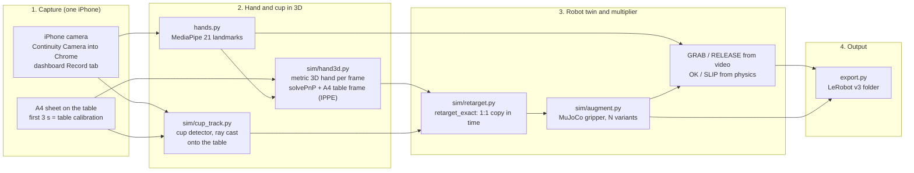

# MIMESIS

**Live demo:** https://lennilehtonen.github.io/mimesis/ (recorded take, MuJoCo twin and variants; the live phone stream and Generate need the local server, see Quickstart)

> **Film one real grab with your phone. Simulate a thousand.**

MIMESIS turns one short phone video of a human hand picking up a cup into a physics-labelled robot dataset. One iPhone films the table (Continuity Camera into Chrome). There is no wrist IMU and no other sensor. A Mac tracks the hand with MediaPipe, lifts it to a metric 3D hand using an A4 sheet on the table as calibration, finds the cup, and makes a robot gripper in MuJoCo copy the human hand 1:1 in time. It then replays that motion across many physically varied worlds (cup or box, mass, friction, size, position) and labels each variant OK or SLIP from the physics. The result is exported as a LeRobot v3 dataset.

The name comes from the Ancient Greek *mimesis*, imitation.

---

## How it works



1. **Record.** The dashboard Record tab records the phone camera in Chrome. An A4 sheet lies on the table. The first 3 s are used to find it.
2. **2D hand.** `hands.py` runs MediaPipe Hands and writes 21 landmarks per frame.
3. **3D hand.** `sim/hand3d.py` builds a metric 3D hand for each frame. It solves the pose of the MediaPipe world landmarks against the image landmarks with `solvePnP`, using iPhone intrinsics. The A4 sheet is detected and solved with IPPE to give the table frame.
4. **Cup.** `sim/cup_track.py` runs a MediaPipe object detector on each frame to find the cup and casts a ray from the camera onto the calibrated table to place it.
5. **Retarget.** `sim/retarget.py` (`retarget_exact`) makes the robot gripper copy the human hand 1:1 in time:
   - grip centre = midpoint of the thumb tip and the middle fingertip;
   - finger opening drives gripper open and close, with a release debounce;
   - the gripper stays vertical, with yaw taken from the human hand;
   - when the hand is out of view the gripper waits above the table;
   - short tracking gaps do not drop the cup, the gripper keeps holding;
   - lift height is estimated from the cup's apparent size in the image.
6. **Simulate.** `sim/augment.py` runs MuJoCo. While the human hand is closed, the cup is carried and the jaws rest on the cup surface. Variants randomise cup or box, mass, friction, size and position. A variant slips when `m * (g + |a_hand|) > 2 * mu * F_grip`. The digital twin itself (the unmodified scene) never slips.
7. **Label and export.** GRAB / RELEASE events come from finger opening in the video. OK / SLIP labels come from the physics. `export.py` writes a LeRobot v3 folder.

`process_video_only` and `multiply_video` in `jobs.py` run this pipeline. More detail: [docs/ARCHITECTURE.md](docs/ARCHITECTURE.md) and [docs/SIMULATION.md](docs/SIMULATION.md).

---

## Features

- **One phone, no wearables.** The iPhone is the camera, streamed to Chrome with Continuity Camera. Nothing to install on the phone.
- **Recording in the browser.** The Record tab records the video and uploads it on stop. Processing starts automatically.
- **Metric 3D hand from monocular video.** MediaPipe landmarks plus `solvePnP` with iPhone intrinsics, anchored to the table through an A4 sheet (IPPE).
- **Cup tracking.** A MediaPipe object detector finds the cup each frame and places it on the calibrated table.
- **1:1 retargeting.** The gripper follows the human hand in time: grip centre, open and close, yaw. No scripted pick-and-place.
- **Grip-force slip model.** Fast moves and heavy or slippery cups fail, and the physics labels them.
- **Domain-randomised variants** of object type, mass, friction, size and position, each labelled OK or SLIP.
- **GRAB / RELEASE events** from finger opening in the real video.
- **LeRobot v3-style export** (parquet + mp4 + `meta/info.json`).
- **Dashboard** with Record, Episode, Multiply and Ship tabs.

---

## What you need

| Item | Notes |
|---|---|
| Phone | Any recent iPhone, used through Continuity Camera. Nothing to install on it. |
| Stand | Phone stand or tripod, about 50 cm above the table, pointing down at about 45°. It must not move during a take. |
| A4 sheet | One plain sheet of paper, flat on a darker table, fully in view. |
| Cup | Next to the sheet. |
| Mac | Apple Silicon or Intel, Python 3.11 or 3.12, `ffmpeg`, Chrome, this repository. |

---

## How to film a take

1. Put the phone on a stand about 50 cm above the table, pointing down at about 45°. It must not move during the take.
2. Lay an A4 sheet flat on a darker table. The whole sheet must be in view, with some margin around it.
3. Put the cup next to the sheet.
4. Press **RECORD** in the dashboard Record tab. Wait 3 s with no hand in view (table calibration).
5. With your right hand only: come in, grab the cup from above, lift it about 10 cm, move it, put it down, open your hand and pull out.
6. Press stop.

Keep the whole hand in view the entire time. Use one hand only.

---

## Quickstart

```bash
# macOS, Python 3.12, ffmpeg (brew install ffmpeg)
./run.sh
```

`run.sh` creates `.venv`, installs `requirements.txt` on first run, starts `receiver.py` on port 8000 and opens the dashboard at http://localhost:8000. Open it in Chrome and pick the iPhone (Continuity Camera) as the camera.

**Dashboard** (keys `1` to `4` switch tabs):

| Tab | What it does |
|---|---|
| 1 Record | Live phone camera with a hand skeleton. RECORD records the video and uploads it on stop. Processing starts automatically. |
| 2 Episode | The real video with the hand skeleton next to the MuJoCo twin, with the same timing. GRAB / RELEASE events. Newest take first. |
| 3 Multiply | Generate N physics variants in a grid and see which are OK and which SLIP. |
| 4 Ship | Dataset card and export to LeRobot v3. |

**Command line** (same jobs the dashboard runs):

```bash
python jobs.py process <episode>          # video-only takes go to process_video_only
python jobs.py multiply <episode> --n 10  # video takes use multiply_video
python jobs.py metrics
python jobs.py export
```

**Test** (synthetic end to end, no phone needed):

```bash
.venv/bin/python test_pipeline.py
```

---

## Results

Measured on 21 Nov 2026 on the real take `ep_173510` (48.7 s, A4-calibrated):

| Metric | Value |
|---|---|
| Frames with the hand found | 68 % |
| Frames with the cup found | 95 % |
| Digital twin | grasps the cup and lifts it 12 cm |
| Variants | 10 variants: 7 OK, 3 SLIP (the slips are low-friction or heavy cups) |
| `test_pipeline.py` | ALL 10 CHECKS PASSED |

### Earlier prototype: wrist IMU

Earlier the same day we built a version with a second iPhone strapped to the wrist (Sensor Logger, 100 Hz). These numbers are from that prototype, not from the current video-only pipeline. 10 real takes of "pick up cup" (1,447 s total), multiplied into 300 MuJoCo variants from one take (`ep_155834`).

| Metric | Value |
|---|---|
| Wrist IMU ingest | 99.7 Hz effective over USB Personal Hotspot |
| Contact events (GRAB / SET-DOWN / TAP / SLIP) | 475 events over 10 takes |
| Simulated variants | 300 variants: 99 success, 149 slip, 52 other failures |
| Contact detection, sim + real training, held-out real takes (leave-one-take-out) | balanced accuracy 77 %, ROC-AUC 0.85 |
| Contact detection, real-only training (leave-one-take-out) | balanced accuracy 70 % |
| Contact detection, sim-only training, zero-shot on all 10 real takes | balanced accuracy 65 %, ROC-AUC 0.75 |
| LeRobot v3 export | real: 10 episodes, 48,085 frames; sim: 300 episodes, 120,000 frames |

Labels on the real IMU data come from `contact_detect.py` (a rule-based detector), not from human annotation. Adding simulation to the real training data raised held-out balanced accuracy from 70 % to 77 %. The code for this path is still in the repository (see below).

---

## Repository structure

```
memesis/
  README.md
  requirements.txt
  run.sh                   # one command: venv, server, dashboard
  receiver.py              # FastAPI server: dashboard, uploads, jobs (also /data ingest for the wrist-IMU prototype)
  jobs.py                  # pipeline jobs: process / multiply / metrics / export
  hands.py                 # MediaPipe Hands, 21 landmarks per frame
  export.py                # LeRobot v3-style packager
  test_pipeline.py         # synthetic end-to-end test (no phone)
  web/                     # dashboard (shell.html + screens/*.html -> index.html, vendored MediaPipe JS)
  scripts/                 # build_ui.py, make_synthetic.py, find_mac_ip.sh
  sim/
    scene.py               # procedural MuJoCo tabletop and gripper
    hand3d.py              # metric 3D hand per frame (solvePnP + A4 table frame)
    cup_track.py           # cup detection and placement on the table
    retarget.py            # retarget_exact: hand -> gripper trajectory
    augment.py             # MuJoCo twin and domain-randomised variants
    demo_grid.py           # real | twin | variant grid video
    sim_to_real.py         # wrist-IMU prototype: train on sim IMU, test on real IMU
  contact_detect.py        # wrist-IMU prototype: contact events from IMU
  sync.py                  # wrist-IMU prototype: clap sync of video and IMU
  live_viz.py              # wrist-IMU prototype: live / replay IMU dashboard
  docs/
    ARCHITECTURE.md
    SIMULATION.md
    DATASET.md
    DATA_COLLECTION.md     # wrist-IMU prototype
    API.md                 # receiver API (Sensor Logger parts are wrist-IMU prototype)
    PITCH.md               # wrist-IMU prototype pitch
```

Runtime data is written under `data/` and is not shipped in the repository.

---

## Dataset format

`export.py` writes a LeRobot v3-style folder:

```
<out-dir>/
  README.md
  meta/info.json
  meta/stats.json
  meta/tasks.parquet
  meta/episodes.parquet
  data/chunk-000/file-000.parquet
  videos/observation.images.egocentric/chunk-000/ep_XXXX.mp4
```

Per-frame features in `data/chunk-000/file-000.parquet`:

| Feature | Shape | Contents |
|---|---|---|
| `index`, `episode_index`, `frame_index`, `task_index`, `timestamp` | scalar | Frame indexing; `timestamp` is video time in seconds |
| `observation.images.egocentric` | video | Real camera or rendered MuJoCo RGB |
| `observation.state` | `[14]` | State vector (kept from the wrist-IMU schema; see DATASET.md) |
| `observation.hands` | `[22]` | Hand presence, wrist / thumb tip / index tip, wrist speed |
| `observation.contact_event_id` | `[1]` | Event code (`2` grab_onset, `4` set_down / release, `0` idle, ...) |
| `observation.contact_flag` | `[1]` | Binary contact flag |
| `observation.slip_score` | `[1]` | Sim variants: `1.0` if the variant slipped |

Full schema: [docs/DATASET.md](docs/DATASET.md).

---

## Limitations

- **Monocular depth is approximate.** The 3D hand comes from one camera. Expect about ±2 to 5 cm depth error.
- **Needs the A4 sheet and a fixed camera.** If the sheet is missing or the phone moves during a take, the table calibration is wrong.
- **Hand tracking drops** when the hand is side-on to the camera or covered by the cup. Today this left the hand found in 68 % of frames.
- **The gripper is a simplified two-jaw hand**, not a model of every human finger.
- **Carried-object slip uses a grip-force model**, not contact physics. The cup is carried while the hand is closed and slips out when `m * (g + |a_hand|) > 2 * mu * F_grip`.
- MuJoCo offscreen rendering must stay on the main thread on macOS.

---

## Roadmap

- Better 3D hand: known hand size or a second calibrated camera to cut depth error.
- More objects and tasks than one cup.
- Larger variant sets per take and a trained grasp policy evaluated on them.
- Optional wrist IMU as a high-rate contact channel, reusing the prototype code.

---

Built at NullHacks Helsinki, 21 Nov 2026.

## License

Copyright (c) 2026 MIMESIS contributors.

Permission is hereby granted, free of charge, to any person obtaining a copy of this software and associated documentation files (the "Software"), to deal in the Software without restriction, including without limitation the rights to use, copy, modify, merge, publish, distribute, sublicense, and/or sell copies of the Software, and to permit persons to whom the Software is furnished to do so, subject to the following conditions:

The above copyright notice and this permission notice shall be included in all copies or substantial portions of the Software.

THE SOFTWARE IS PROVIDED "AS IS", WITHOUT WARRANTY OF ANY KIND, EXPRESS OR IMPLIED, INCLUDING BUT NOT LIMITED TO THE WARRANTIES OF MERCHANTABILITY, FITNESS FOR A PARTICULAR PURPOSE AND NONINFRINGEMENT. IN NO EVENT SHALL THE AUTHORS OR COPYRIGHT HOLDERS BE LIABLE FOR ANY CLAIM, DAMAGES OR OTHER LIABILITY, WHETHER IN AN ACTION OF CONTRACT, TORT OR OTHERWISE, ARISING FROM, OUT OF OR IN CONNECTION WITH THE SOFTWARE OR THE USE OR OTHER DEALINGS IN THE SOFTWARE.
