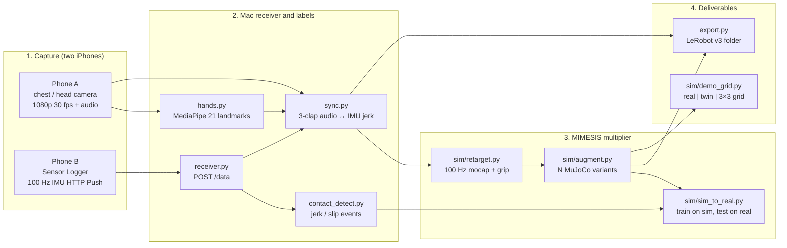

# MIMESIS

**μίμησις** *(mímēsis)* — Ancient Greek for *imitation*: the representation of the real world in another medium.

> **Record one real demo with your phones. Simulate a thousand.**

MIMESIS is a zero-hardware **real-to-sim physical-AI data multiplier**. Two ordinary iPhones capture a short egocentric manipulation demo (chest video + 100 Hz wrist IMU). A Mac retargets that demonstration into MuJoCo, multiplies it across physically varied worlds (mass, friction, size, timing, sensor noise), and exports a LeRobot-style dataset of simulated wrist IMUs, contact forces, slip/drop labels, and rendered RGB. A small classifier trained **only on simulated IMU windows** is then evaluated zero-shot on the **real** phone IMU — the sim-to-real check that makes the pipeline more than a renderer.

Built at [NullHacks Helsinki](docs/PITCH.md) (21 November 2026). Theme: *“Everyone is working on physical AI… find an awesome way to **simulate** any data you find cool. End result could be a dataset, a model, a simulation that could be deployed to collect this data, whatever.”* Judged on coolness, technical complexity, and creativity.

License: [MIT](#license).

---

## Why this exists

Physical-AI labs cannot scrape a Common Crawl of contact. Egocentric video is cheap; **force, slip onset, and “how hard did I set this down” are not**. Pure wearable IMUs look like a shortcut to XYZ position, but double-integrating a consumer accelerometer drifts **meters in seconds** (bias integrates as \(t^2\); attitude error lets gravity leak and can grow as \(t^3\)). Teleoperation rigs and tactile fingers are expensive. What scales is a **collection protocol plus a physics multiplier**: record a real human demonstration once, then simulate the rare failures and contact transients labs actually need.

MIMESIS does not claim that IMU-only XYZ is solved. The opposite is the point: **the camera supplies coarse kinematic ground truth; the wrist IMU (real and simulated) supplies high-rate dynamics and contact.** Simulation is how you get privileged slip/drop labels and a thousand physical variants from one 10-second clip.

---

## How it works



Full data-flow, timestamp conventions, clap-sync math, and coordinate frames: [docs/ARCHITECTURE.md](docs/ARCHITECTURE.md).

---

## Features

- **No native iOS code.** Phone B streams with the free **Sensor Logger** app (Kelvin Choi). Phone A is the built-in Camera app. The Mac is the only software you write and run.
- **100 Hz wrist IMU ingest** via FastAPI (`POST /data`), with an offline CSV import fallback when venue Wi-Fi isolates devices.
- **MediaPipe Hands** (Tasks API `HandLandmarker`, with a legacy `mp.solutions.hands` fallback) over a video file or a live Continuity Camera feed.
- **Clap-sync** of video audio against IMU jerk, typically to about **10 ms** on the synthetic test clip.
- **Contact event detection** (`idle`, `motion`, `grab_onset`, `impact_or_tap`, `set_down`, `slip_or_scrape`) from jerk, high-pass vibration, and rest/motion context.
- **MuJoCo retargeting** of the real wrist into a mocap-welded dynamic two-finger gripper (Apple Silicon–safe; EGL only on headless Linux).
- **Domain-randomized data multiplier**: cup/box, mass, friction, scale, XY offset, time-warp, MEMS bias/noise; privileged `success` / `slipped` labels from physics, not from a human annotator.
- **Zero-shot sim-to-real check**: `RandomForestClassifier` trained only on simulated 200 ms IMU windows, evaluated on real `contact_detect.py` labels.
- **LeRobot v3-style export** (parquet + mp4 + `meta/info.json`) for both real aligned episodes and simulated variants.
- **Stage demo asset**: side-by-side *real clip | MuJoCo twin | 3×3 augmented grid* with success/slip tags.

---

## Hardware and apps

| Role | Device | App / setting |
|---|---|---|
| Phone A — egocentric RGB + audio | Any iPhone with a rear camera (Ultra-Wide helps) | Built-in **Camera**: Video, **1080p at 30 fps**, **0.5× Ultra-Wide**, **Audio ON**. Mount on a chest lanyard / hoodie pocket / cap, angled ~35° down at the tabletop so both hands stay in frame. |
| Phone B — wrist IMU | iPhone strapped flat to the back of the dominant wrist or forearm | **Sensor Logger** by Kelvin Choi (App Store, free tier is enough). |
| Receiver / sim / export | MacBook (Apple Silicon or Intel), Python 3.11 or 3.12, `ffmpeg` | This repository. |

**Sensor Logger (Phone B) — exact settings used by `receiver.py`:**

1. **Settings → Sensor Configuration:** turn **Standardise Units & Frames = ON** (right-handed frames, acceleration in m/s²). Leave **Uncalibrated Values = OFF**.
2. On the **Logger** tab, enable **only** these four sensors, each at **100 Hz** (or period `0.01 s`):
   - **Accelerometer** (calibrated linear acceleration, gravity removed)
   - **Gyroscope** (rad/s)
   - **Orientation** (`qx, qy, qz, qw, roll, pitch, yaw`)
   - **Gravity** (`x, y, z`)
3. Logger gear → **HTTP Push = ON**, URL = `http://<MAC_IP>:8000/data` (printed by `python receiver.py`).
   The free tier batches pushes roughly once per second, but **every 100 Hz sample is included in the `payload` array with a UTC epoch-nanosecond timestamp.** Local on-phone recording is also written and can be AirDropped as a CSV zip if HTTP never arrives.

Capture protocol, the 18-task list, and Wi-Fi / hotspot troubleshooting: [docs/DATA_COLLECTION.md](docs/DATA_COLLECTION.md).

---

## Quickstart

```bash
# Python 3.11 or 3.12. Install ffmpeg if needed: brew install ffmpeg
python3 -m venv .venv && source .venv/bin/activate
pip install -r requirements.txt

# End-to-end synthetic verification (~45–60 s). No phones required.
python test_pipeline.py

# Pre-fetch the MediaPipe hand model (also downloaded automatically on first use)
python -c "from hands import ensure_hand_model; ensure_hand_model()"
```

`test_pipeline.py` exercises HTTP ingest, contact detection, clap-sync, real and sim LeRobot export, retargeting, 12 MuJoCo variants (9 rendered), sim-to-real, and `demo_grid.py`.

---

## Step-by-step usage

Work from the repository root with the virtualenv activated. Create output folders as you go (`mkdir -p data/videos data/raw_imu data/hands data/aligned data/sim_aug`).

### 0. Optional: name the episode before you record

```bash
python receiver.py --host 0.0.0.0 --port 8000 --out-dir data/raw_imu
```

In another terminal (or after a test recording):

```bash
curl -s -X POST http://127.0.0.1:8000/episode/start \
  -H 'Content-Type: application/json' \
  -d '{"episode_id":"ep_001","task":"pick_place_mug"}'
```

`receiver.py` also accepts `--import-csv-dir`, `--episode-id`, and `--task` for offline Sensor Logger CSV folders (see [docs/API.md](docs/API.md)).

### 1. Capture one demo (3 claps)

1. Put the Mac and Phone B on the **same Wi-Fi or a personal hotspot** (venue Wi-Fi often isolates clients).
2. Start `python receiver.py --port 8000` and copy the printed `http://<MAC_IP>:8000/data` into Sensor Logger HTTP Push.
3. Hit **Record** on Phone A (Camera) and Phone B (Sensor Logger) at about the same time.
4. In the first three seconds, **clap sharply three times** in front of the chest camera — this is the sync signal for `sync.py`.
5. Perform the task (20–30 s). End with a brief rest of the object on the table (helps `set_down` detection).
6. Stop both recorders. AirDrop the `.MOV` / `.MP4` into `data/videos/` (name it to match the episode, e.g. `ep_001.mov`).

Verify the IMU stream:

```bash
curl -s http://127.0.0.1:8000/status
python live_viz.py --url http://127.0.0.1:8000/latest
```

Stop and flush:

```bash
curl -s -X POST http://127.0.0.1:8000/episode/stop \
  -H 'Content-Type: application/json' -d '{}'
```

This writes `data/raw_imu/ep_001.parquet`, `ep_001.csv`, and `ep_001_meta.json`. If HTTP never worked, AirDrop the Sensor Logger zip, unzip it, and run:

```bash
python receiver.py --import-csv-dir ~/Downloads/ep_001 --episode-id ep_001 --task pick_place_mug --out-dir data/raw_imu
```

### 2. Hands, contacts, clap-sync

```bash
python hands.py data/videos/ep_001.mov \
  --out data/hands/ep_001_hands.parquet \
  --out-video data/hands/ep_001_overlay.mp4

# Optional live overlay (Continuity Camera or Mac webcam)
python hands.py --live --camera 0

python contact_detect.py data/raw_imu/ep_001.parquet \
  --out data/raw_imu/ep_001_contacts.parquet \
  --events-json data/raw_imu/ep_001_contacts.events.json \
  --jerk-thresh 45.0 --accel-thresh 3.5 --slip-thresh 0.75

python sync.py \
  --video data/videos/ep_001.mov \
  --imu data/raw_imu/ep_001.parquet \
  --hands data/hands/ep_001_hands.parquet \
  --out data/aligned/ep_001.parquet \
  --plot data/aligned/ep_001_sync.png \
  --search-window 12.0
```

`sync.py` also writes `data/aligned/ep_001.sync.json` (offset, clap times, correlation peak). You can omit `--hands`; the aligner then interpolates IMU onto video timestamps only.

Offline IMU dashboard (including the naive double-integration drift panel):

```bash
python live_viz.py --replay data/raw_imu/ep_001.parquet --save-png data/aligned/ep_001_dashboard.png
```

### 3. Retarget, multiply, sim-to-real, demo grid

```bash
# Optional standalone retarget (also invoked inside augment.py)
python -m sim.retarget data/aligned/ep_001.parquet --out data/sim_aug/ep_001_retarget.parquet

# 1 real clip → 50 physics variants, first 9 rendered to MP4, plus LeRobot export
python -m sim.augment data/aligned/ep_001.parquet \
  --n 50 --render-n 9 \
  --out-dir data/sim_aug \
  --lerobot-out data/mimesis_lerobot \
  --task pick_place_mug \
  --seed 42

# Train on simulated IMU windows, evaluate zero-shot on the real episode
python -m sim.sim_to_real \
  --sim-dir data/sim_aug/episodes \
  --real data/raw_imu/ep_001.parquet \
  --out-json data/sim_aug/sim_to_real_report.json

# Stage video: [real | MuJoCo twin | 3×3 variant grid]
python -m sim.demo_grid \
  --real-video data/hands/ep_001_overlay.mp4 \
  --sim-dir data/sim_aug \
  --out data/mimesis_demo.mp4 \
  --out-png data/mimesis_demo.png
```

`--real-video` is optional; without it the left pane is a placeholder. Use the MediaPipe overlay MP4 when you have it.

### 4. Export real aligned episodes (separate from sim export)

`sim.augment` already calls `export.py` for simulated variants into `--lerobot-out`. To package **real** clap-synced episodes:

```bash
python export.py \
  --aligned-dir data/aligned \
  --video-dir data/videos \
  --out-dir data/airtruth_lerobot \
  --fps 30.0 \
  --repo-id nullhacks/airtruth-ego-imu
```

Or pass an explicit manifest (JSON list of `{episode_id, task, aligned_parquet, video_path}`):

```bash
python export.py --manifest episodes.json --out-dir data/airtruth_lerobot --repo-id nullhacks/airtruth-ego-imu
```

Schema: [docs/DATASET.md](docs/DATASET.md). Simulation internals: [docs/SIMULATION.md](docs/SIMULATION.md).

---

## Repository structure

```
rig/
  README.md
  requirements.txt
  receiver.py              # FastAPI Sensor Logger ingest + CSV import
  hands.py                 # MediaPipe Hands → 21 landmarks + speeds
  contact_detect.py        # Jerk / slip event detector
  sync.py                  # Clap-sync audio ↔ IMU, frame-aligned parquet
  export.py                # LeRobot v3-style packager
  live_viz.py              # Live / replay IMU + drift dashboard
  test_pipeline.py         # Synthetic end-to-end test (no phones)
  sim/
    __init__.py
    scene.py               # Procedural MuJoCo tabletop + welded gripper
    retarget.py            # Real episode → 100 Hz mocap + grip_ctrl
    augment.py             # Domain-randomized multiplier + sim export
    sim_to_real.py         # Train on sim IMU, test on real IMU
    demo_grid.py           # real | twin | 3×3 grid MP4 / PNG
  docs/
    ARCHITECTURE.md
    DATA_COLLECTION.md
    SIMULATION.md
    DATASET.md
    API.md
    PITCH.md
    TEAM_PLAN.md
```

Runtime data (created when you run the pipeline, not shipped in the repo):

```
data/raw_imu/              # receiver.py  (ep_*.parquet, .csv, _meta.json)
data/videos/               # AirDropped Phone A clips
data/hands/                # hands.py
data/aligned/              # sync.py  (plus .sync.json, optional _sync.png)
data/sim_aug/
  episodes/                # 100 Hz sim IMU parquets (+ optional *_30fps.parquet)
  videos/                  # rendered sim_vXXXX.mp4
  manifest.json
  sim_to_real_report.json
data/mimesis_lerobot/      # export of simulated variants
data/airtruth_lerobot/     # export of real aligned episodes
```

---

## Dataset format (summary)

Both real and simulated exports use a LeRobot v3-style layout:

```
<out-dir>/
  README.md
  meta/info.json
  meta/stats.json
  meta/tasks.parquet
  meta/episodes.parquet
  data/chunk-000/file-000.parquet
  videos/observation.images.egocentric/chunk-000/ep_XXXX.mp4
```

Per-frame features in `data/chunk-000/file-000.parquet`:

| Feature | Dtype | Shape | Contents |
|---|---|---|---|
| `index`, `episode_index`, `frame_index`, `task_index`, `timestamp` | int64 / float32 | scalar | Frame indexing; `timestamp` is video time `t_s` in seconds |
| `observation.images.egocentric` | video | declared `[1080, 1920, 3]` | Chest-cam or rendered MuJoCo RGB (actual encoded size may differ) |
| `observation.state` | float32 | `[14]` | `ax, ay, az, gx, gy, gz, qx, qy, qz, qw, grav_x, grav_y, grav_z, jerk_mag` |
| `observation.hands` | float32 | `[22]` | Left/right presence, wrist / thumb tip / index tip (normalized x,y,z), wrist speed (px/s) |
| `observation.contact_event_id` | int32 | `[1]` | `0` idle, `1` motion, `2` grab_onset, `3` impact_or_tap, `4` set_down, `5` slip_or_scrape |
| `observation.contact_flag` | int32 | `[1]` | Binary contact / transient |
| `observation.slip_score` | float32 | `[1]` | Real: high-pass vibration RMS; sim variants: `1.0` if the episode slipped |

`codebase_version` in `info.json` is `v3.0-airtruth-hack`. Default `--repo-id` for real exports is `nullhacks/airtruth-ego-imu`; simulated exports from `sim.augment` use `nullhacks/mimesis-sim-aug`. Full column lists for intermediate parquets: [docs/DATASET.md](docs/DATASET.md).

---

## Results

Replace the placeholders with numbers from **your recorded episodes** before the pitch. Synthetic figures below come from `python test_pipeline.py` on this box (no phones) and must be labeled as such if you mention them.

| Metric | On real phone data (fill in) | Synthetic regression test (`test_pipeline.py`) |
|---|---|---|
| Clap-sync offset error | _TBD ms_ (see `data/aligned/*.sync.json`) | **10.0 ms** (`offset = +0.810 s` vs truth `+0.800 s`) |
| Contact transients found on one clip | _TBD_ | 8 transients + `slip_or_scrape` on the synthetic IMU |
| Simulated variants / success / slip | _TBD_ (see `data/sim_aug/manifest.json`) | 12 variants: **7 success, 5 slips**, 9 MP4s rendered |
| Zero-shot sim→real contact detection | _accuracy / balanced accuracy / F1 / ROC-AUC from `sim_to_real_report.json`_ | **ROC-AUC 0.81**, balanced acc. 60.8%, accuracy 55.5% on the **synthetic-real** clip |
| Real episodes in LeRobot export | _TBD frames @ 30 fps_ | 210 frames from the 7 s synthetic video |
| Demo assets | `data/mimesis_demo.mp4`, `data/mimesis_demo.png` | Built successfully (~265 KB MP4, ~205 KB PNG in the test run) |

The synthetic AUC is a pipeline smoke test, not a claim about generalization to a held-out human. After you record real demos, run `python -m sim.sim_to_real --sim-dir data/sim_aug/episodes --real data/raw_imu/ep_001.parquet data/raw_imu/ep_002.parquet ...` and put those numbers on the slide.

---

## Why you cannot sell raw IMU XYZ

A wrist accelerometer measures **specific force**. To get position you subtract gravity (which requires an accurate attitude) and **integrate twice**. A constant accelerometer bias \(b\) produces a position error \(\tfrac{1}{2} b t^2\). A small attitude error lets gravity leak into the “linear” channels and can make position error grow even faster. On a **stationary** smartphone this already reaches **several meters in about 10 seconds**.

`live_viz.py --replay <parquet>` panel 3 does exactly this: it subtracts a short initial mean and double-integrates `ax, ay, az`. The trace walks off the table. That is why MIMESIS uses the camera (and MediaPipe, when present) as the coarse translational channel, and the IMU for orientation, jerk, and contact — and why the multiplier lives in **MuJoCo**, not in a second integrator.

---

## Limitations (honest)

- **Monocular MediaPipe “world” landmarks are not metric mocap.** They live in a hand-centered frame; absolute depth is weak. Retargeting uses them as a coarse tabletop mapping, or falls back to a contact-locked kinematic script when landmarks are missing.
- **The wrist phone is bulky** compared with a watch, ring, or dedicated IMU. Mount rigidity and soft tape affect high-frequency content.
- **Simulation is a pinch gripper, not a human hand.** Contacts, friction cones, and slip labels are physically consistent *inside the engine*, not a digital twin of skin or a GelSight.
- **Sim-to-real numbers on synthetic IMU are not the same as numbers on a real mug.** Report them separately. The classifier is a 16-feature random forest on 200 ms windows, not a foundation model.
- **Free-tier Sensor Logger HTTP Push is batched (~1 s)**, not a 10 ms HTTP request per sample. Timestamps inside the batch are still 100 Hz. Venue networks may block phone→Mac HTTP entirely — use a hotspot or the CSV import path.
- **`export.py` task names** from auto-discovery look for a `task` field in `*.sync.json`. `sync.py` does not currently write `task` there, so folder-mode real exports default to `egocentric_manipulation` unless you pass `--manifest`. Simulated exports set `task` to `{--task}_success` or `{--task}_slip`.
- **Rendered sim video is 320×240** from `side_cam` at ~30 fps; `info.json` still declares egocentric video as `[1080, 1920, 3]`. Treat that shape as a schema hint, not a guaranteed resolution.
- MuJoCo offscreen rendering must stay on the **main thread** on macOS. Do not start a second `Renderer` from a background worker.

---

## Roadmap

- **Collection protocol as the product.** An app in which any two phones become a calibrated capture kit, and the Mac (or a small server) is the multiplier — closer to how data engines actually sell, rather than one afternoon of one person’s hands.
- **IMU as a high-rate residual.** Keep the camera as the slow/absolute channel; train a model that predicts inter-frame delta pose and contact events from IMU, especially under occlusion.
- **Watch kinematic chain.** Apple Watch on the wrist + one phone on the chest (and optionally a finger-mounted IMU) for a two-link upper-limb dataset. Sensor Logger already has a Watch companion; this repo does not ingest it yet.
- **Poor-man’s tactile.** Accel jerk plus optional contact-mic audio as tap / slip / set-down labels — a cheap proxy for instrumented fingers, still generated at scale in sim.
- Tighter metric retargeting (known hand size or a second calibrated camera), and closing the loop by deploying the sim-trained contact detector on-device.

---

## Team

| Person | Role at NullHacks Helsinki |
|---|---|
| _Name_ | Capture — mounts, Sensor Logger, `receiver.py`, recording |
| _Name_ | Vision and sync — `hands.py`, `sync.py`, `live_viz.py` |
| _Name_ | Simulation and ML — `sim/retarget.py`, `sim/augment.py`, `sim/sim_to_real.py` |
| _Name_ | Export and pitch — `export.py`, `sim/demo_grid.py`, repository, 5-minute talk |

Hour-by-hour plan to the 18:30 EET submission (feature freeze 17:45): [docs/TEAM_PLAN.md](docs/TEAM_PLAN.md). Pitch script and Q&A: [docs/PITCH.md](docs/PITCH.md).

---

## Documentation

| Doc | Contents |
|---|---|
| [docs/ARCHITECTURE.md](docs/ARCHITECTURE.md) | Data flow, timestamps, clap-sync math, coordinate frames |
| [docs/DATA_COLLECTION.md](docs/DATA_COLLECTION.md) | Protocol, 18 tasks, networking troubleshooting |
| [docs/SIMULATION.md](docs/SIMULATION.md) | MuJoCo scene, retargeting, domain randomization, IMU noise, labels |
| [docs/DATASET.md](docs/DATASET.md) | Intermediate and LeRobot schemas |
| [docs/API.md](docs/API.md) | `receiver.py` endpoints and Sensor Logger payload |
| [docs/PITCH.md](docs/PITCH.md) | 5-minute script and Q&A |
| [docs/TEAM_PLAN.md](docs/TEAM_PLAN.md) | Four-person split and schedule |

---

## License

Copyright (c) 2026 MIMESIS contributors.

Permission is hereby granted, free of charge, to any person obtaining a copy of this software and associated documentation files (the “Software”), to deal in the Software without restriction, including without limitation the rights to use, copy, modify, merge, publish, distribute, sublicense, and/or sell copies of the Software, and to permit persons to whom the Software is furnished to do so, subject to the following conditions:

The above copyright notice and this permission notice shall be included in all copies or substantial portions of the Software.

THE SOFTWARE IS PROVIDED “AS IS”, WITHOUT WARRANTY OF ANY KIND, EXPRESS OR IMPLIED, INCLUDING BUT NOT LIMITED TO THE WARRANTIES OF MERCHANTABILITY, FITNESS FOR A PARTICULAR PURPOSE AND NONINFRINGEMENT. IN NO EVENT SHALL THE AUTHORS OR COPYRIGHT HOLDERS BE LIABLE FOR ANY CLAIM, DAMAGES OR OTHER LIABILITY, WHETHER IN AN ACTION OF CONTRACT, TORT OR OTHERWISE, ARISING FROM, OUT OF OR IN CONNECTION WITH THE SOFTWARE OR THE USE OR OTHER DEALINGS IN THE SOFTWARE.
