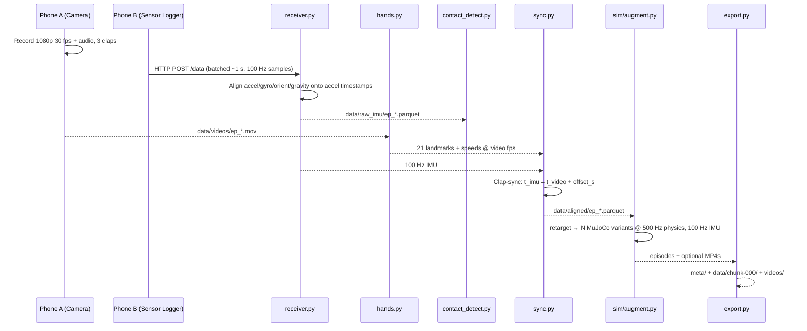

# Architecture

This document describes how a two-phone demonstration becomes a LeRobot-style dataset and a MuJoCo-multiplied sibling corpus. Implementation lives in the Python modules named below; commands and flags are listed in the root [README](../README.md).

## 1. Pipeline stages

1. **Ingest.** `receiver.py` accepts Sensor Logger HTTP Push batches (or an unzipped CSV folder). Streams are interpolated onto the primary accelerometer timestamps and written as `data/raw_imu/<episode_id>.parquet`.
2. **Vision.** `hands.py` runs MediaPipe Hands on the chest-cam file (or `--live`) and writes per-frame landmarks plus wrist/index speeds.
3. **Contacts.** `contact_detect.py` (also called inside `sync.py`, `sim/retarget.py`, and `sim/sim_to_real.py`) labels transients on the 100 Hz IMU.
4. **Sync.** `sync.py` estimates a single scalar offset between video time and IMU time from the three opening claps, then interpolates IMU and contact labels onto every video frame.
5. **Retarget.** `sim/retarget.py` resamples the aligned (or raw IMU) episode to 100 Hz and builds a mocap pose + gripper command. If MediaPipe wrist landmarks are present and finite on enough frames, translation and pinch come from the camera; otherwise a contact-locked kinematic script is used, lightly modulated by real accel.
6. **Multiply.** `sim/augment.py` steps a procedural MuJoCo scene at `timestep=0.002` (500 Hz), records simulated IMU at 100 Hz, renders a subset of variants at ~30 fps, and optionally calls `export.py`.
7. **Transfer check.** `sim/sim_to_real.py` trains only on simulated windows and tests on real IMU labels.
8. **Demo.** `sim/demo_grid.py` composites real video, one twin replay, and up to nine variant cells.

## 2. Timestamps

| Source | Clock | Unit | Notes |
|---|---|---|---|
| Sensor Logger `payload[].time` | UTC Unix | **nanoseconds** (int) | Confirmed by the official HTTP Push schema. |
| `receiver.py` `timestamp_ns` | same | ns | Copied from `time`. |
| `receiver.py` `t_rel_s` | episode-relative | seconds | `(timestamp_ns - first) / 1e9`. |
| Phone A video | container time | seconds | `t_s = frame_idx / fps` in `hands.py`; fps from OpenCV `CAP_PROP_FPS` (or `ffprobe` `r_frame_rate` in `sync.py`). |
| Audio for sync | WAV after `ffmpeg` | 16 kHz mono | Extracted with `ffmpeg -vn -ac 1 -ar 16000`. |
| Aligned parquet `t_s` | **video clock** | seconds | After clap-sync. |
| Aligned parquet `t_imu_s` | IMU clock | seconds | `t_s + offset_s`. |
| Simulated IMU `t_s` / `t_rel_s` | MuJoCo time | seconds | Starts at 0; warped by `time_warp` applied to the retargeted trajectory. |
| LeRobot `timestamp` | video / export fps | seconds | Copied from `t_s`. Simulated exports downsample with `df.iloc[::3]` (~33 Hz rows for 30 fps video). |

Alignment of Sensor Logger streams **inside** one HTTP session (`align_session_streams` in `receiver.py`):

- The primary clock is the `accel` stream (falling back to `accel_raw`, then the longest stream).
- Other sensors are interpolated with `numpy.interp` after subtracting a shared `int64` start timestamp and converting the remainder to seconds. That subtraction keeps nanosecond spacing accurate in `float64`.
- Duplicate `time` rows are dropped before interpolation.

There is **no NTP handshake** between Phone A and Phone B. Cross-device alignment is entirely the clap offset from `sync.py`.

## 3. Clap-sync mathematics

Implemented in `sync.estimate_clap_offset`.

1. Restrict both signals to the first `--search-window` seconds of video (default **12 s**) so later task impacts do not dominate.
2. Build a **10 ms** (`bin_s = 0.01`) grid.
3. **Audio envelope:** maximum absolute amplitude in each 10 ms bin of the 16 kHz wav, zeroed after the search window, median-subtracted, peak-normalized, then squared.
4. **IMU envelope:** jerk magnitude \(\lVert \Delta\mathbf{a} / \Delta t \rVert\) interpolated onto the same grid, same normalization.
5. **Cross-correlation.** `scipy.signal.correlate(imu_env, audio_env, mode="full")`. A peak at lag \(\tau\) means the IMU envelope delayed by \(\tau\) lines up with the audio (i.e. \(t_\text{imu} \approx t_\text{video} + \tau\)). Lags outside \(\pm\) **8 s** (`max_lag_s`) are ignored.
6. **Peak snap.** The first strong audio peak and the IMU peak nearest to `t_clap_video + xcorr_offset` refine \(\tau\) to the 10 ms grid.

`align_episode` then:

- Interpolates continuous IMU columns (`ax…az`, `gx…gz`, quaternions, Euler, gravity, `jerk_mag`, `slip_score`, …) onto `t_video + offset_s`.
- Assigns discrete `contact_event_id` / `contact_flag` by taking the **max** id/flag inside a ± half-frame window (so a 100 Hz transient is not lost between 30 fps frames).

On the synthetic regression test, recovered offset was **+0.810 s** versus a planted **+0.800 s** (**10 ms** error).

## 4. Coordinate frames

### Phone B / Sensor Logger (real IMU)

With **Standardise Units & Frames = ON**, Sensor Logger maps iOS values onto Android-style **right-handed** axes and reports calibrated acceleration in **m/s²** (not g). `receiver.py` stores:

- `ax, ay, az` — calibrated linear acceleration (gravity removed), phone body frame.
- `gx, gy, gz` — gyroscope, rad/s, same frame. Standardization does not flip gyro signs (Sensor Logger documentation).
- `grav_*` — gravity vector in the body frame.
- `qx, qy, qz, qw` and `roll, pitch, yaw` — device orientation. Yaw zero and north reference can still differ slightly between iOS (true north) and Android (magnetic north) even with standardization; MIMESIS uses **relative** orientation in retargeting (`roll/pitch/yaw` minus the first sample, clipped).

The phone is strapped to the **dorsal wrist**. The body frame is therefore a wrist frame only up to a fixed mount rotation, which is not calibrated in this repo.

### MediaPipe Hands

`hands.py` writes, per landmark \(i=0\ldots20\):

- `{left,right}_x{i}, _y{i}, _z{i}` — image-normalized coordinates from the landmarker (`x,y` in \([0,1]\) of the frame, `z` roughly in the same units, camera-relative).
- `{left,right}_wx{i}, _wy{i}, _wz{i}` — MediaPipe **world** landmarks, in a **hand-centered** metric-ish frame, **not** a gravity-aligned world frame and not reliable absolute depth from monocular RGB.

Wrist speed columns are in **pixels per second**, using image width/height and `dt` from `t_s`.

Index map used by retargeting: `0` wrist, `4` thumb tip, `8` index tip.

### MuJoCo world (`sim/scene.py`)

- Right-handed, **Z up**, gravity `(0, 0, -9.81)`.
- Table top is at \(z=0\) (table geom centered at `z=-0.025`, half-height `0.025`).
- `wrist_mocap` / `wrist_body` translation is in meters in this world.
- MuJoCo quaternions are stored **`(w, x, y, z)`** (`mocap_qw…qz`, `framequat`).
- The `<accelerometer>` on `imu_site` reports **specific force** in the body frame (at rest, approximately \(+9.81\) along the body axis that aligns with world \(+Z\)). `sim/augment.py` subtracts gravity expressed in the body frame to produce linear acceleration comparable to Sensor Logger’s calibrated accelerometer, then adds bias and noise (see [SIMULATION.md](SIMULATION.md)).

### Retarget mapping (camera → MuJoCo)

When MediaPipe wrist coordinates are usable, `sim/retarget.py` approximately maps normalized image coordinates to a tabletop patch:

- \(x_\text{mocap} = \mathrm{clip}((w_x - w_x[0]) \cdot 0.40,\,-0.16,\,0.16)\)
- \(y_\text{mocap} = \mathrm{clip}((0.65 - w_y) \cdot 0.35 - 0.10,\,-0.22,\,0.14)\)
- \(z_\text{mocap} = \mathrm{clip}(0.24 - (w_y - \min w_y) \cdot 0.25,\,0.085,\,0.24)\)

This is a **coarse, hackathon-scale** calibration, not a solved PnP. The IMU-only fallback ignores image coordinates and uses contact times to stitch a reach–grasp–lift–place path in the same world frame.

## 5. Process and threading notes

- `receiver.py` serves FastAPI/uvicorn and is safe to poll from `live_viz.py` (`GET /latest`).
- `mujoco.Renderer` is created, stepped, and closed on the **same thread** inside `simulate_variant`. On macOS this must remain the main thread. On headless Linux, `configure_gl_backend()` sets `MUJOCO_GL=egl` if `DISPLAY` is unset.
- `sim/demo_grid.py` writes a temporary `mp4v` file, then transcodes to H.264 (`libx264`, `yuv420p`) with `ffmpeg` so the file plays in QuickTime, Keynote, and Chrome.
